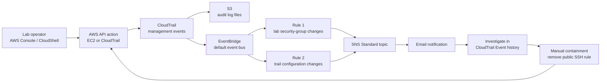
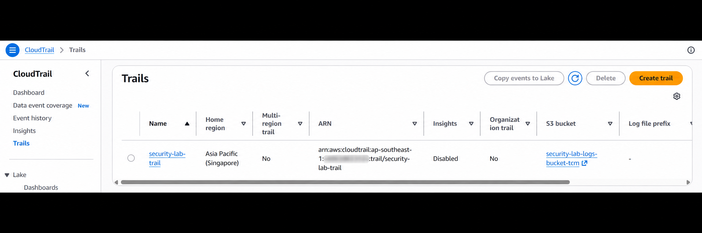
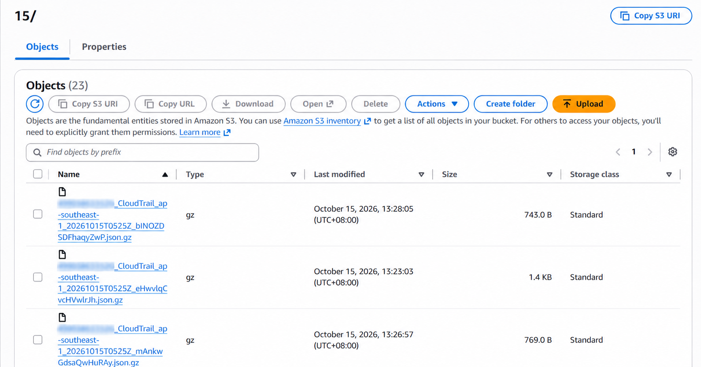
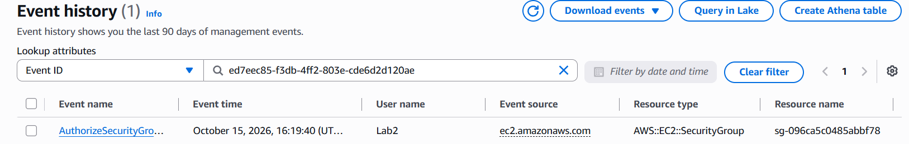
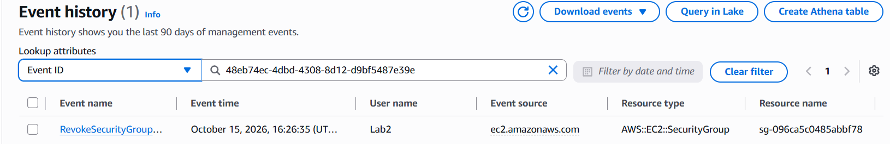
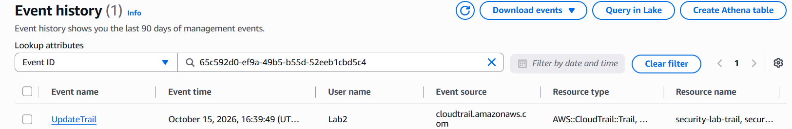
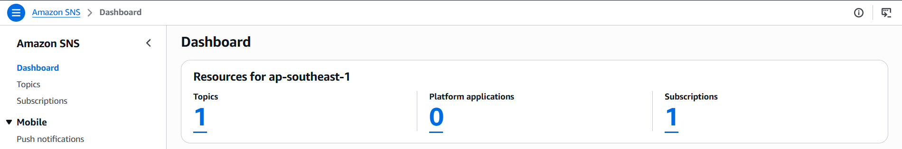
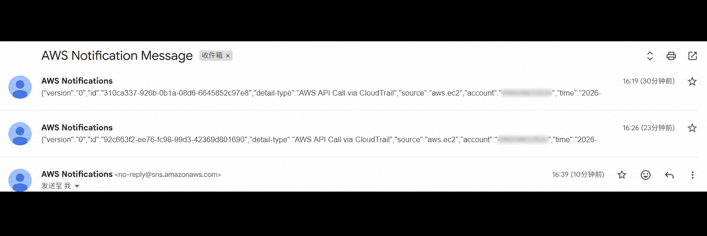

# AWS Security Monitoring & Incident Response Lab

**CloudTrail · Amazon EventBridge · Amazon SNS · Amazon S3**

I built and tested an AWS monitoring workflow that sends email alerts when selected security configurations change. I used CloudTrail to investigate the actor and request details, removed a simulated risky SSH rule, and verified that the removal generated a second alert.

**Lab date:** 15 October 2026 · **Region:** Asia Pacific (Singapore), `ap-southeast-1` · **Response:** Manual

## Results at a glance

| Test | Expected signal | Observed result |
| --- | --- | --- |
| Add an inbound SSH rule allowing `0.0.0.0/0` | `AuthorizeSecurityGroupIngress` | SNS email received; matching CloudTrail event found |
| Remove that inbound rule | `RevokeSecurityGroupIngress` | SNS email received; CloudTrail recorded successful revocation |
| Update the lab trail while keeping log-file validation enabled | `UpdateTrail` | SNS email received; matching CloudTrail event found |
| Deliver audit logs to S3 | CloudTrail log objects | `.json.gz` objects appeared in the regional date folders |

The security group used for the exercise was kept unattached to workloads. No EC2 instance was needed to produce the configuration-change events. These were controlled tests performed by the lab operator, not evidence of an attacker.

## Architecture



S3 retains log files; EventBridge receives the CloudTrail events separately. The rules do not scan the S3 bucket. AWS documents that this integration requires an active logging trail and that CloudTrail events arrive on the default event bus. [AWS integration documentation](https://docs.aws.amazon.com/eventbridge/latest/userguide/eb-service-event-cloudtrail.html)

## Why I adapted the original design

The original lab included GuardDuty. My Free-plan account could not access GuardDuty, so I used explicit EventBridge event patterns for the exercises.

This demonstrates audit logging, event filtering, notification delivery, investigation, and manual response. It does **not** reproduce GuardDuty's managed threat intelligence or anomaly detection. Account eligibility and pricing should be checked again before reproducing the lab; this repository does not promise a zero-cost deployment.

## Components and scope

| Component | Configuration used |
| --- | --- |
| CloudTrail | `security-lab-trail`; single Region; read/write management events; log-file validation enabled during setup; global service events excluded |
| S3 | Dedicated private bucket; public access blocked; SSE-S3 encryption |
| EventBridge | Existing `default` event bus; two event-pattern rules |
| SNS | Standard topic `security-lab-alerts`; email subscription |
| Security group | `security-lab-sg`; unattached; inbound SSH permission added and then removed |
| CloudShell | AWS CLI and Python/Boto3 to configure and inspect the resources |

CloudTrail Lake, Insights, data-event logging, additional compute workloads, and automatic remediation were outside this lab's scope.

## Detection logic

### 1. Security-group inbound changes

`security-lab-sg-changes` matches `AuthorizeSecurityGroupIngress` and `RevokeSecurityGroupIngress` for the specified lab security-group ID.

The rule alerts on these API actions **regardless of port or CIDR**. The analyst determines whether the change is risky by examining the request. It does not cover every way security-group rules can be modified, and a matching request must be checked for success or failure.

See [the event pattern](patterns/security-group-changes.json).

### 2. CloudTrail configuration changes

`security-lab-trail-changes` matches `UpdateTrail`, `PutEventSelectors`, `StopLogging`, and `DeleteTrail` events in the selected account and Region. It is not restricted to one trail name.

Only **`UpdateTrail` was exercised** in this lab. Stopping or deleting the trail was not used as a detection test. The rule is not a guaranteed protection against disabling the logging infrastructure it depends on.

See [the event pattern](patterns/cloudtrail-changes.json).

Both rules forward the full matched event to SNS. The scripts use `ENABLED_WITH_ALL_CLOUDTRAIL_MANAGEMENT_EVENTS`, retaining the explicit CloudTrail-management-event state used in the successful exercise. Their event patterns still limit which actions match.

## Evidence

### Audit trail and S3 delivery



*The trail list confirms the trail name and home Region. The visible “Disabled” value belongs to the Insights column; this screenshot does not show the trail's logging status.*



*CloudTrail delivered compressed log objects to S3. Account-number prefixes in filenames have been obscured.*

### Detection and investigation



*The inbound-rule addition was recorded at 16:19:40 Malaysia time. The request details showed TCP port 22 and source `0.0.0.0/0`.*

### Containment



*At 16:26:35 Malaysia time, I removed the public SSH permission. The notification's response data included `_return: true` and the revoked rule details.*

### Trail change detection



*The trail update was recorded at 16:39:49 Malaysia time, and the second detection rule delivered an email notification.*

<details>
<summary>Supporting SNS and notification screenshots</summary>



*The dashboard shows one topic and one subscription. It does not show the subscription's confirmation state; successful email delivery was the functional check.*



*The inbox shows notifications received during the exercise. The collapsed previews alone do not establish which API action each message contains.*

</details>

**Evidence handling:** Screenshots 01, 02, and 04 were processed with an AI image-editing tool to obscure account numbers and may differ in dimensions or rendering from the original captures. The Event history screenshots 05–07 are unedited captures supplied from the lab. Screenshots containing source IP addresses and raw notification payloads are excluded from this public package. See the [evidence notes](docs/evidence-notes.md).

## Reproduce the lab

Follow the [setup and validation guide](docs/setup.md). It covers the S3 policy, single-Region trail, SNS subscription, isolated security group, rules, and test actions.

The rule setup script consolidates the CloudShell commands used during the exercise:

```bash
python3 scripts/create-alert-rules.py \
  --security-group-id sg-REPLACE_WITH_YOUR_LAB_GROUP \
  --region ap-southeast-1
```

Use your own account and resource values. This script expects an existing `security-lab-alerts` SNS topic and an active trail. It creates or updates the two named rules and merges its publishing permission into the SNS topic policy. It does not create a custom event bus.

**Validation boundary:** The live tests documented here used the earlier CloudShell commands during the lab. The packaged scripts consolidate that workflow and have received local validation; they have not been redeployed into AWS as a separate test run.

## Investigation and lessons learned

- **Permissions and names must agree.** An incorrect Region string in the S3 bucket policy's trail ARN caused `InsufficientS3BucketPolicyException`. Correcting it to `ap-southeast-1` resolved the setup issue.
- **Console navigation changes.** When rule controls were difficult to locate, CloudShell configured the existing default bus directly. It used the same account permissions as the console.
- **An email and Event history can appear at different times.** The alert arrived before I located the matching record in Event history. Searching with `detail.eventID`, the correct Region, and the appropriate time range resolved the investigation.
- **An API event is evidence of a request.** The event name, identity, request parameters, and response/error fields must be read together to establish what happened.
- **Containment needs verification.** Removing the inbound rule produced a separate CloudTrail event and SNS notification, giving evidence of the response action.

Read the [incident report](docs/incident-report.md) for the timeline and evidence interpretation, and the [troubleshooting guide](docs/troubleshooting.md) for the issues encountered.

## Limits and next improvements

This is a single-account, single-Region learning environment. It does not provide organization-wide logging, complete change coverage, guaranteed event delivery, immutable evidence storage, or automated response. Email is the only alert destination, and approved changes can also trigger notifications.

Potential next improvements include a failed-delivery queue, alert-delivery monitoring, handling `ModifySecurityGroupRules`, structured event enrichment, and narrowly scoped remediation with approval. These are future work, not implemented features.

## Cost and cleanup

The design avoided EC2 instances and paid networking components. S3 requests/storage and SNS usage can consume applicable allowances or credits; other AWS usage in the account also matters. Check [CloudTrail pricing](https://aws.amazon.com/cloudtrail/pricing/), [EventBridge pricing](https://aws.amazon.com/eventbridge/pricing/), and [SNS pricing](https://aws.amazon.com/sns/pricing/) before deployment.

Follow the [cleanup guide](docs/cleanup.md) after saving evidence. Cleanup instructions are supplied, but completion was **not recorded** in the evidence used for this write-up.

## Repository contents

```text
aws-security-monitoring-lab/
├── README.md
├── docs/
│   ├── setup.md
│   ├── incident-report.md
│   ├── troubleshooting.md
│   ├── cleanup.md
│   └── evidence-notes.md
├── patterns/
│   ├── security-group-changes.json
│   └── cloudtrail-changes.json
├── policies/
│   └── cloudtrail-bucket-policy.template.json
├── scripts/
│   ├── create-alert-rules.py
│   └── remove-alert-rules.py
├── screenshots/
├── requirements.txt
└── .gitignore
```

**Skills demonstrated:** CloudTrail investigation, IAM resource policies, EventBridge event patterns, SNS notifications, AWS CLI, Python/Boto3, manual containment, and evidence-based incident documentation.
